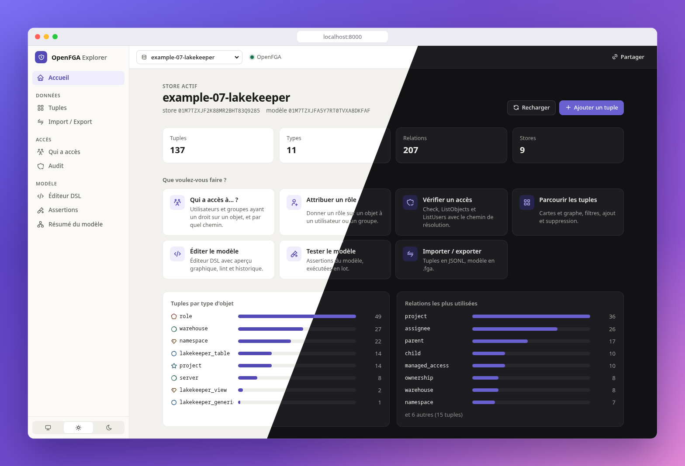
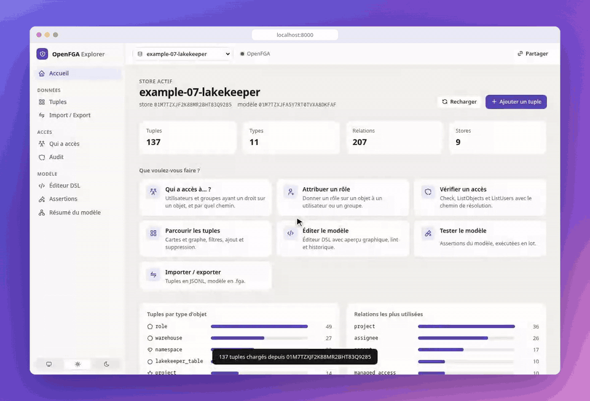
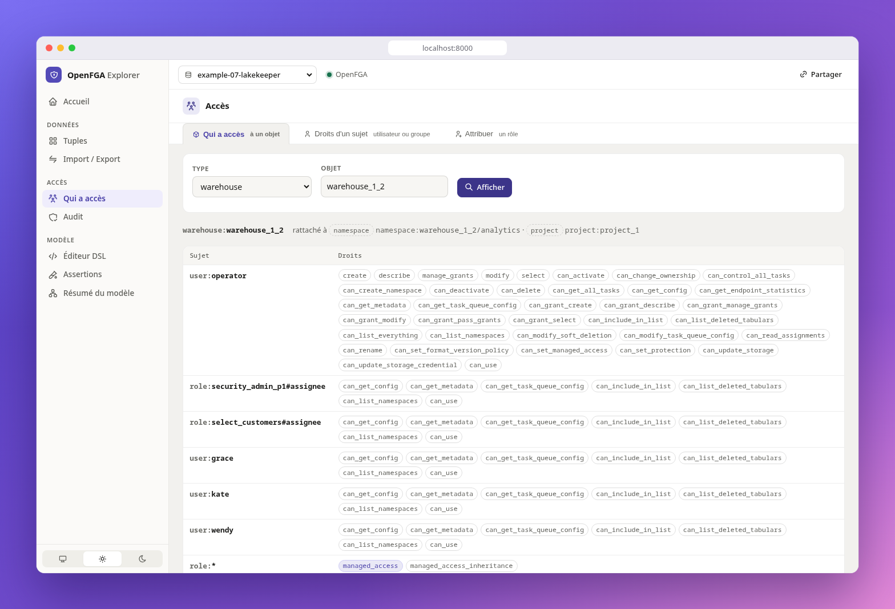
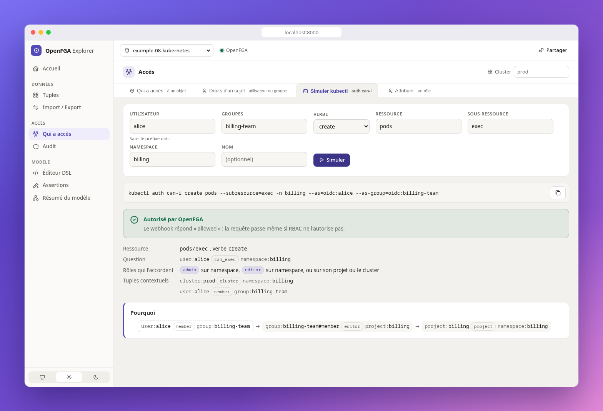
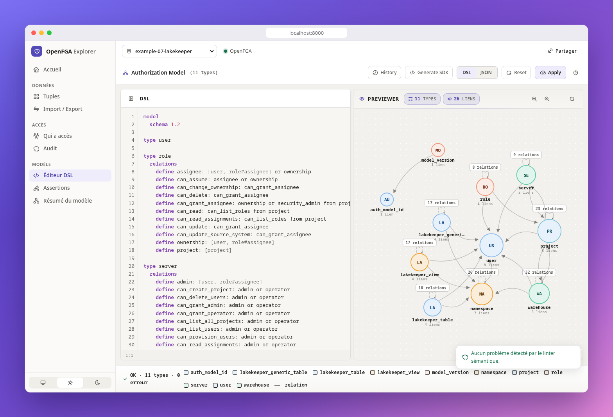
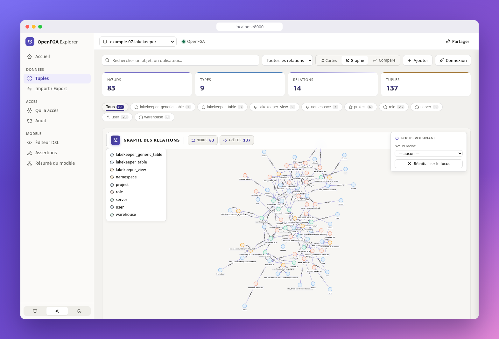

> [!NOTE]
> 99% of this project's code (including this README) was generated via AI-assisted coding.

<div align="center">

# OpenFGA Explorer

**See who has access to what in OpenFGA, and why.**

A web UI to browse, edit and audit [OpenFGA](https://openfga.dev) stores:
access answered in terms of roles, a live model editor, an audit toolkit,
and a `kubectl auth can-i` simulator for Kubernetes authorization models.

[](LICENSE)




</div>

## Why

OpenFGA answers one question at a time: *can this user do this on that
object?* Operating it day to day needs the other questions too: who has
access to this object, through which role or group, what does this person
hold, what changes if I assign this role. OpenFGA Explorer answers them from
the store itself, without writing queries.

## Features

- **Access, in plain terms.** Pick an object and see every user and group that
  holds a right on it, then why: the group membership, the role tuple and the
  parent object that carry the access. Or start from a person to list
  everything they hold. Assign a role from a sentence ("give *editor* on
  *project:billing* to *group:billing-team*") with a preview of what it grants.
- **`kubectl auth can-i` simulator.** For models used by an OpenFGA-backed
  Kubernetes authorization webhook: type a user, groups, verb and resource, get
  the decision, the roles that would grant it and the resolution path.
- **Model editor.** DSL with syntax highlighting and a live graph of types and
  relations, lint, version history, store-to-store diff, and client code
  generation (TypeScript, Go, Python, curl).
- **Audit toolkit.** `Check`, `ListObjects` and `ListUsers` with contextual
  tuples, and the "Why?" path for every positive answer.
- **Tuples.** Cards or force-directed graph, filters, neighbourhood focus,
  staged changes reviewed before writing, live updates, JSONL import with
  preview and export.
- **Assertions.** Write and run tests against the active model.
- **Made to be used.** Light and dark themes, keyboard navigation, WCAG AA
  contrast, works on a phone. Every view has a shareable URL.
- **Ready for production.** OIDC login with admin and read-only roles, local
  break-glass account, CSRF protection, hashed-script CSP, distroless image,
  Helm chart.

## Demo



## Quick start

OpenFGA and the Explorer, with eight demo stores, in one command:

```bash
git clone https://github.com/GeindreauQ/openfga-explorer.git
cd openfga-explorer
docker compose -f docker-compose.yml -f examples/seeder.yml up --build
```

Open <http://localhost:8000> and sign in as `admin`. The password is printed in
the container logs at first boot (look for `SECURITY`). The demo stores cover
GitHub-like permissions, expiring grants, IP allowlists, Google Drive, a data
lakehouse and a Kubernetes cluster (`example-08-kubernetes`, for the kubectl
simulator).

Drop `-f examples/seeder.yml` to start with an empty OpenFGA. To try single
sign-on, add `-f examples/authentik.yaml`: it starts Authentik with an
`openfga` application already configured.

## A closer look

<table>
<tr>
<td width="50%"><br><b>Who has access</b>: every subject with a right on the object, direct or inherited. Click one to see the path.</td>
<td width="50%"><br><b>kubectl simulator</b>: the same translation as the webhook, with the contextual tuples it would send.</td>
</tr>
<tr>
<td width="50%"><br><b>Model editor</b>: DSL on the left, the type graph updating as you type on the right.</td>
<td width="50%"><br><b>Tuples graph</b>: objects and subjects as a force-directed graph, with focus on a neighbourhood.</td>
</tr>
</table>

The full walkthrough is in [`docs/web-ui.md`](docs/web-ui.md).

## Deploy

### Helm

```bash
helm upgrade --install openfga-explorer ./charts/openfga-explorer \
  --set openfga.url=http://openfga.openfga.svc.cluster.local:8080 \
  --set auth.secret.sessionSecret.existingSecret=openfga-explorer \
  --set oidc.issuerUrl=https://sso.example.com/application/o/openfga-explorer/ \
  --set oidc.clientId=openfga-explorer \
  --set oidc.redirectUrl=https://openfga-explorer.example.com/auth/callback \
  --set oidc.existingSecret=openfga-explorer
```

Every value is described in [`values.yaml`](charts/openfga-explorer/values.yaml);
[`docs/deployment.md`](docs/deployment.md) covers TLS, proxies and hardening.

### Docker

```bash
docker run -p 8000:8000 \
  -e OPENFGA_URL=http://openfga:8080 \
  -e SESSION_SECRET="$(openssl rand -hex 32)" \
  -e ADMIN_PASSWORD="$(openssl rand -hex 16)" \
  openfga-explorer
```

Build the image with `docker build -t openfga-explorer .`.

### From source

Go 1.25 or later:

```bash
cd src/server
OPENFGA_URL=http://localhost:8080 AUTH_DISABLED=1 go run .
```

## Configuration

Environment variables, the essentials:

| Variable | Purpose |
|---|---|
| `OPENFGA_URL` | OpenFGA HTTP API. The store is chosen in the UI. |
| `OPENFGA_TOKEN` | Pre-shared key, if OpenFGA requires one. `OPENFGA_OIDC_*` fetches a token from an identity provider instead. |
| `OIDC_ISSUER_URL`, `OIDC_CLIENT_ID`, `OIDC_CLIENT_SECRET`, `OIDC_REDIRECT_URL` | Single sign-on (Keycloak, Authentik, Auth0, Okta…). |
| `OIDC_ADMIN_GROUPS`, `OIDC_VIEWER_GROUPS` | Groups mapped to the admin and read-only roles. |
| `SESSION_SECRET` | Signs session cookies. Required in production. |
| `ADMIN_PASSWORD` | Local `admin` account. Random and logged when unset. |
| `AUTH_DISABLED` | `1` turns authentication off, for local demos only. |

All variables, with defaults and security notes:
[`docs/environment-variables.md`](docs/environment-variables.md). Type colours
and icons, timeouts and limits can be tuned in an optional
[`config.yaml`](docs/configuration.md).

## Documentation

| | |
|---|---|
| [Web UI](docs/web-ui.md) | Every page, with screenshots |
| [Environment variables](docs/environment-variables.md) | Configuration reference |
| [`config.yaml`](docs/configuration.md) | Tuning and theme |
| [HTTP API](docs/api.md) | Every backend endpoint |
| [Deployment](docs/deployment.md) | Docker, Helm, production hardening |

## Development

```
src/server/   Go backend: OpenFGA client, auth (OIDC, sessions), HTTP API
src/web/      Frontend: ES modules and plain CSS, no bundler
charts/       Helm chart
examples/     Demo stores, seeder and Authentik overlays
tests/        Unit tests (vitest) and end-to-end suites (Playwright)
scripts/      Screenshots, README visuals and demo recording
```

```bash
(cd src/server && go test ./...)      # backend
(cd tests && npm install)
(cd tests && npx vitest run)          # frontend units
(cd tests && node run_all.mjs)        # end to end, against a running stack
```

The screenshots, the framed README images and the demo are generated:
`scripts/take-screenshots.mjs`, `scripts/readme-visuals.mjs` and
`scripts/make-demo.mjs`, run against the quick-start stack with
`AUTH_DISABLED=1`.

## Limitations

- **One replica.** Sessions, local accounts and the login rate limiter live in
  memory: sessions are lost on restart and the chart runs a single replica.
- **Whole-store reads.** The tuples views load the full store; fine up to tens
  of thousands of tuples.
- **Roles are read at sign-in.** A group change in the identity provider
  applies at the next session.

Open items are tracked in [`TODO.md`](TODO.md).

## License

[Apache 2.0](LICENSE)
