# Web UI Guide

A walkthrough of every page in the OpenFGA Explorer, with what it does, where to find
it, and how the store URL (i.e., the OpenFGA instance you connect to) flows through
the UI.

> **Store URL, end-to-end**: `OPENFGA_URL` (set on the server) → header banner displays
> the live value → store selector lists all stores reachable on that URL → every
> page consumes whichever store is currently selected. No reload required when
> switching stores.

---

## Table of contents

1. [Layout overview](#layout-overview)
2. [Header](#header)
3. [Store selector](#store-selector) ← _the store URL is configurable here_
4. [Connection panel](#connection-panel)
5. [Home dashboard](#home-dashboard)
6. [Tuples — Cards view](#tuples--cards-view)
7. [Tuples — Graph view](#tuples--graph-view)
8. [Admin DSL](#admin-dsl)
9. [Access](#access)
10. [Audit](#audit)
11. [Assertions](#assertions)
12. [Import / Export](#import--export)
13. [Generate SDK](#generate-sdk)
14. [Modals & drawers](#modals--drawers)
15. [Auth flows](#auth-flows)
16. [Keyboard shortcuts](#keyboard-shortcuts)

---

## Layout overview

```
┌────────────────┬─────────────────────────────────────────────────────────┐
│ OpenFGA        │ Top bar: [☰ mobile] [Store selector] [● Connection] [Share] │
│ Explorer       ├─────────────────────────────────────────────────────────┤
│                │                                                         │
│ Accueil        │  Active page (home, tuples, access, audit, DSL, …)      │
│ DONNÉES        │  Each page scrolls on its own; the sidebar and the      │
│  Tuples        │  top bar stay in place.                                 │
│  Import/Export │                                                         │
│ ACCÈS          │                                                         │
│  Qui a accès   │                                                         │
│  Audit         │                                                         │
│ MODÈLE         │                                                         │
│  Éditeur DSL   │                                                         │
│  Assertions    │                                                         │
│  Résumé        │                                                         │
│ [◐ ☀ ☾] theme  │                                                         │
│ user · logout  │                                                         │
└────────────────┴─────────────────────────────────────────────────────────┘
```

Below 900px wide the sidebar becomes a drawer opened with the ☰ button.

---

## Sidebar

| Element | Description |
|---|---|
| **Navigation** | One entry per page, grouped by Data / Access / Model. The current page is highlighted (`aria-current="page"`). Entries are real links (`?tile=…`): Ctrl/Cmd-click opens a page in a new tab. |
| **Résumé du modèle** | Opens the Authorization Model modal (types and relations of the active model). |
| **Theme** | System / light / dark. Every page, the DSL editor and both graphs follow it. The choice is kept in the browser. |
| **User** | Signed-in user, "lecture seule" for viewers, logout. Hidden when auth is disabled. |

## Top bar

| Element | Description |
|---|---|
| **Store selector** | Dropdown listing all stores on the configured `OPENFGA_URL`. See below. |
| **Connection indicator** | Colored dot + short label: green (connected, store selected), orange (no store picked), red (no `OPENFGA_URL`). Click it to open the [Connection panel](#connection-panel). |
| **Share** | Copies the current URL — including view state — to the clipboard. |

---

## Store selector

**This is the place where the store URL is "writable"**: you can switch which OpenFGA
store the entire UI operates on, without restarting anything.

### How it works

1. At boot, the server calls `GET /stores` on `OPENFGA_URL` and stores the list.
2. The frontend reads this list via `GET /api/stores` and populates the dropdown.
3. The first store in the list is auto-selected (you can change it any time).
4. When you pick a different store:
   - the frontend `POST`s to `/api/stores/select` with `{storeId}`,
   - the server validates the ID against the live list, calls `SetStoreID` on the
     client,
   - every page reloads its data (tuples, model, stats).
5. Picking "— Aucun Store Sélectionné —" deselects the current store — useful to
   pause writes without reloading.

### What "OPENFGA_URL" actually does

- It's the only connection-level setting. You configure it **server-side** via env
  (or a Docker / Helm value).
- The frontend never edits it (and can't, intentionally — that would require
  re-creating the SDK client and re-resolving all auth state).
- To point at a different OpenFGA instance, change the env, restart the server.
  All the stores reachable on the new URL become available in the selector.

### Edge cases

- **No stores on the URL**: selector shows only the "Aucun" option, indicator is
  orange, every page shows "Sélectionnez un store".
- **`OPENFGA_URL` not set**: indicator is gray, selector is disabled, pages show
  "OpenFGA non configuré".
- **Store deleted upstream**: the selector keeps the stale ID selected (so the UI
  reflects reality), but writes fail with a 404 from OpenFGA.

---

## Connection panel

Toggle from the ⚙ button in the header.

| Field | Description |
|---|---|
| **État** | Live: green "Connecté à OpenFGA" or gray "OpenFGA non configuré". |
| **URL de l'API** | The current `OPENFGA_URL` (read from `/api/health`). |
| **Stores disponibles** | Comma-separated list of all stores on this instance. |
| **Store actif** | Active store name + ID. |

The panel is read-only — to change anything, restart the server with different env.

---

## Home dashboard

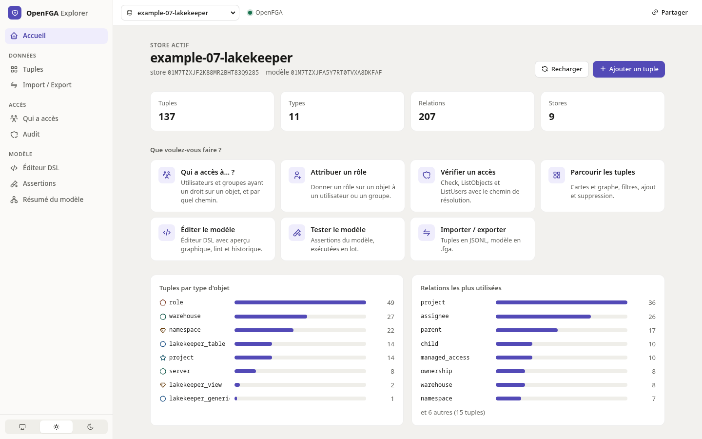

<details><summary>Dark theme</summary>

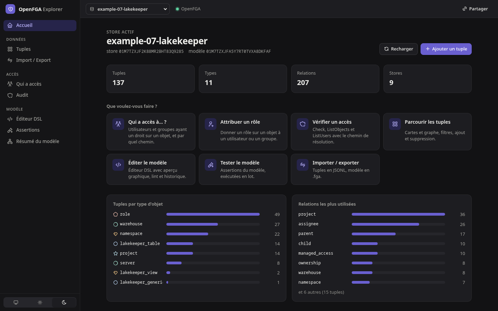

</details>

The landing page, about the active store:

- **Header** — store name and ID, current model ID, a "Kubernetes webhook model" badge when the model is the webhook's, and the *Reload* / *Add tuple* actions.
- **Figures** — tuples, types, relations, stores.
- **Que voulez-vous faire ?** — task shortcuts: who has access, assign a role, simulate kubectl (Kubernetes models only), check an access, browse tuples, edit and test the model, import/export.
- **Breakdown** — tuples per object type and the most used relations.

---

## Tuples — Cards view

The default view on the main page. Each tuple renders as a card grouped by type.

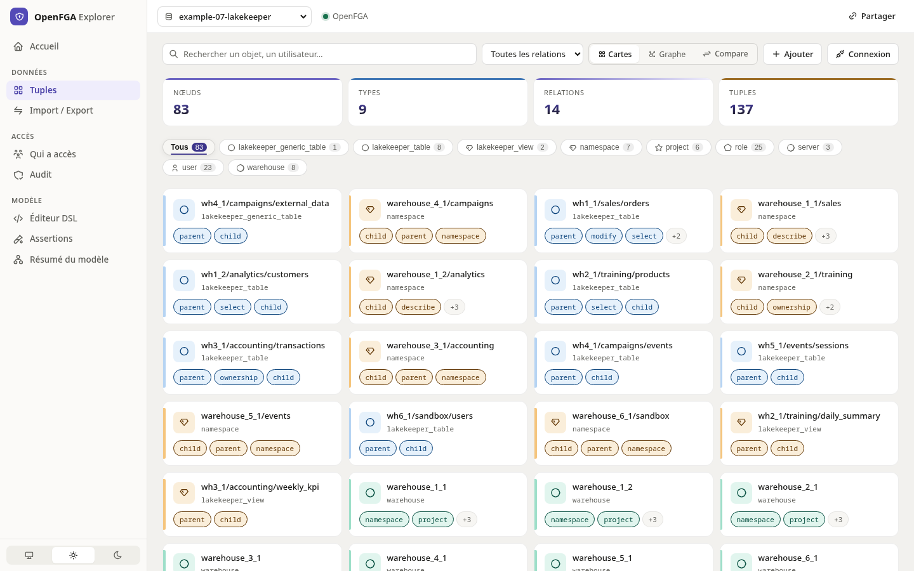

### Toolbar

- **Search** — fuzzy search across object ids, user ids, relations.
- **Relation filter** — narrow by relation (`viewer`, `editor`, `admin`, …).
- **Cards / Graph** — toggle the view.
- **Compare** — pick another store and run a tuple diff.
- **+ Add** — open the Add Tuple modal.
- **⚙ Config** — toggle the connection panel.

### Stats bar

`N tuples · M types · K relations · connected · last refresh Xs ago`

### Type tabs

`[All] [user 12] [document 8] [team 5] …` — click to filter the cards by type.

### Cards

Each card shows the **object** (left, big), the **relation** (center, arrow), and the
**user** (right). Click a card to open the detail modal (see below).

### Pending changes drawer

When you stage adds/removes via the Add modal, a right-edge drawer appears. The
`+ Add` button commits all pending changes in one batch write.

---

## Tuples — Graph view

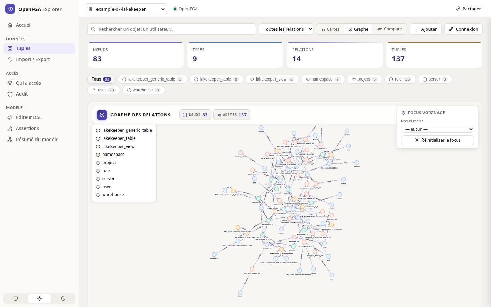

Click **Graph** in the view switch. The cards transform into a force-directed graph
using D3-style physics, with the same colors and icons from your `theme` config.

### Controls

- **Zoom in / out / reset** — buttons on the bottom-right of the graph area.
- **Click a node** — opens the detail modal and (optionally) the tree sidebar.
- **Tree sidebar** — when a node is selected, slides in from the right with
  descendants and ancestors up to N hops (1–5, slider).
- **Focus mode** — bottom-left "Focus voisinage" lets you pin the graph to a
  single root node.

### Loading

The graph engine is served by the Explorer itself and loaded the first time the
graph view opens. If it cannot be loaded, the view says so and offers to retry
or to go back to the cards.

---

## Admin DSL

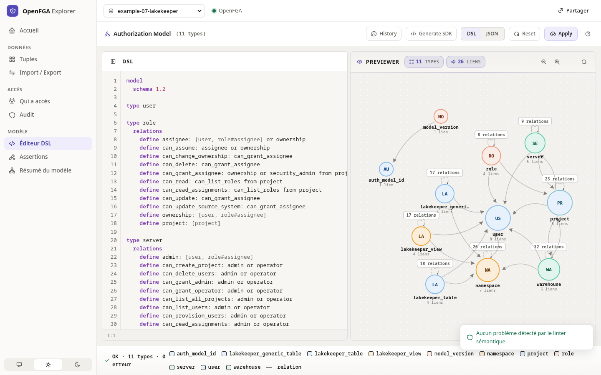

The flagship editor. Inspired by the Auth0 FGA playground.

### Header

- **Authorization Model** + type count.
- **Home** — back to dashboard.
- **History** — opens the modal listing past authorization model versions.
- **Generate SDK** — opens the SDK codegen modal (TS / Go / Python / curl).
- **DSL / JSON** toggle — switch between the human-readable DSL and its JSON shape.
- **Reset** — reload the DSL from the backend.
- **Apply** — push the current DSL as a new authorization model version.
- **?** — show the welcome tour (first visit only).

### Split-pane

- **Left** — DSL editor with syntax highlighting. Validates on every keystroke.
- **Right** — live graph preview of types and relations. Updates as you type.

### Footer

- **Validation status** — `✓ Valid` or a list of errors (lint panel).
- **Legend** — type icon swatches.

### Apply flow

1. Edit the DSL.
2. The status bar updates: red if invalid, green if OK.
3. Click **Apply**.
4. The frontend `POST`s to `/api/dsl/apply`, which writes a new authorization model
   version. The page shows the new model ID and the graph re-renders.

### Lint

A side panel (`dsl-lint-panel`) flags semantic issues — undefined types, missing
relations, unused types — before you push.

---

## Access

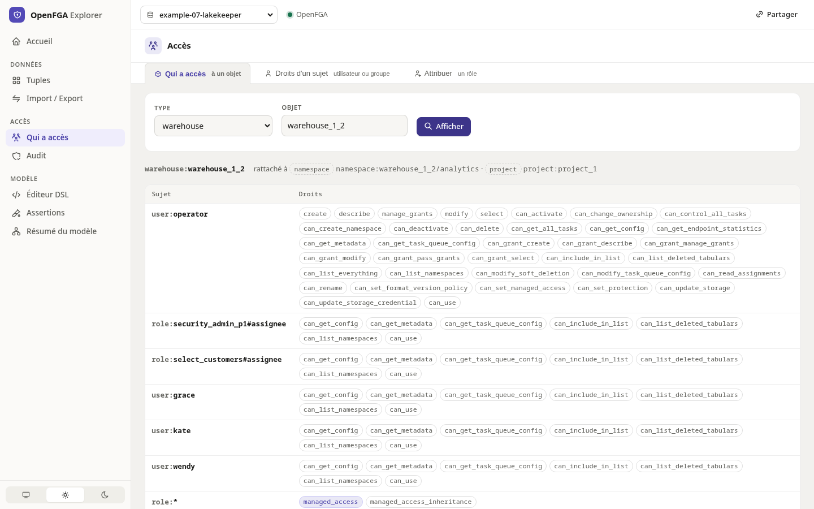

Answers access questions in terms of roles rather than raw queries. It works
with any model; the **Simulate kubectl** tab only appears when the store holds
the model of an OpenFGA-backed Kubernetes authorization webhook
(types `cluster` and `namespace` with the `can_*` permissions).

| Tab | Question | How |
|---|---|---|
| **Who has access** | _Who holds which role or permission on this object?_ | ListUsers for each relation and subject type (users and `group#member`), shown as a matrix (● direct tuple, ○ inherited); relations granted to nobody are left out, and past eight relations each subject lists its rights as badges instead (filled: direct). Clicking a row shows the paths: group membership → tuple → links (`project`, `cluster`) up to the object. Direct tuples can be revoked from there. |
| **Subject rights** | _What can this user or group reach?_ | ListObjects for each type and relation, with the strongest role per object. For a user, the groups typed in are sent as contextual tuples, like the `groups` claim of a token. |
| **Simulate kubectl** | _Would `kubectl auth can-i …` be allowed by OpenFGA?_ | Translates the request exactly like the webhook (same verb → permission mapping, same contextual tuples), runs the Check and explains the answer. When it is denied, it offers the roles that would grant it. RBAC is not simulated: the webhook only adds rights, so "no OpenFGA right" means RBAC decides. |
| **Assign** | _Give `role` on `object` to `subject`._ | A sentence-shaped form with known objects and subjects suggested, a preview of what the role implies, and the object's direct tuples with revoke buttons. Hidden for read-only users. |

For Kubernetes models, the **Cluster** field in the header names the cluster
(the webhook's `CLUSTER_NAME`). It defaults to the first `cluster:*` found in
the tuples. Each namespace is linked to it on the fly, as the webhook does, so
rights granted on the cluster show up on every namespace.

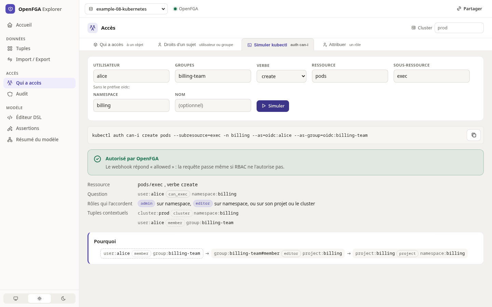

## Audit

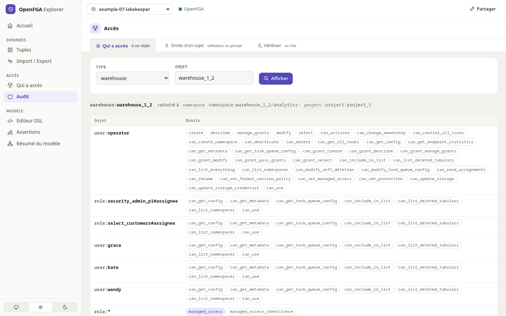

Three modes, sharing the same form + results split layout.

### Modes

| Mode | Question it answers | Inputs |
|---|---|---|
| **Check** | _Does `user` have `relation` on `object`?_ | user, relation, object, optional CEL context |
| **Reverse** | _Who has `relation` on `object`?_ | relation, object, optional user-type filter |
| **Forward** | _What does `user` have `relation` on?_ | user, relation, object type, optional CEL context |

### Results

- Allowed / denied badge.
- For Check: the **resolution path** ("Why?") — a chain of tuples explaining
  how the access was granted. Uses the native OpenFGA `/expand` endpoint internally.
- For Reverse / Forward: a list of users / objects, each expandable to its own
  resolution path.

---

## Assertions

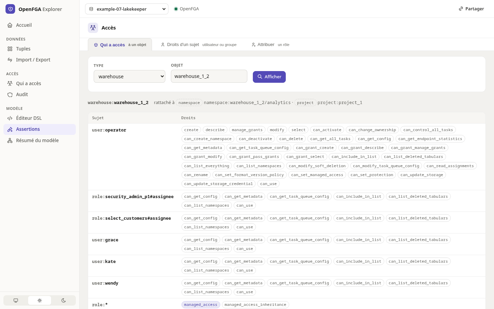

Unit tests for your authorization model. Bound to the active model version: changing
the model invalidates the assertions (warning banner explains).

### Columns

`User | Relation | Object | Expected (allowed/denied) | actions`

### Actions

- **Sauvegarder** — persist the current list to the active model.
- **Tout exécuter** — run every assertion against the live tuples, display pass/fail.
- **Add row** — append a new assertion with the form at the bottom.

---

## Import / Export

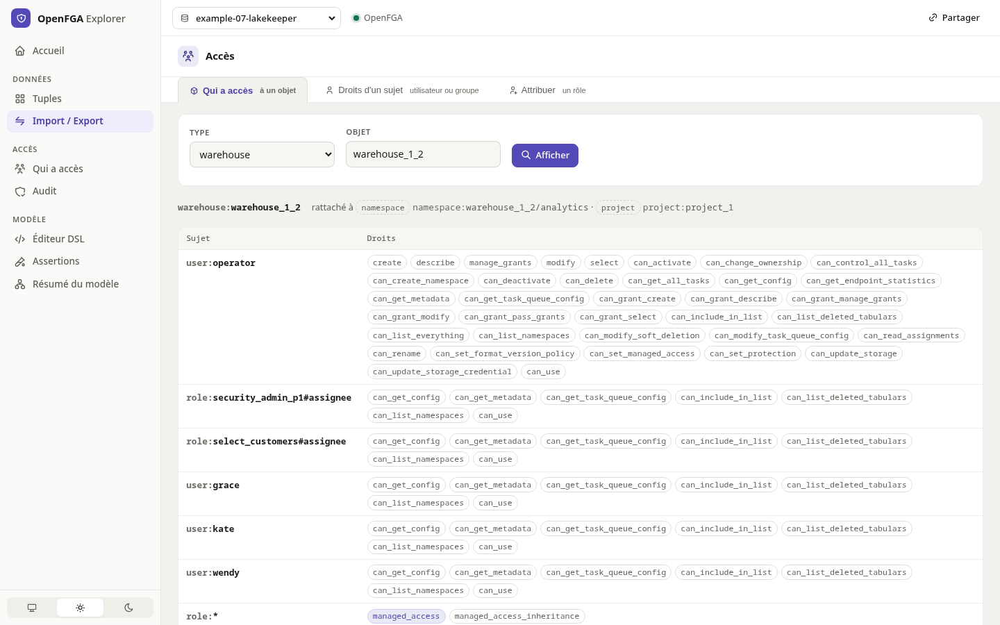

Three tabs.

### Export

- **Tuples → JSONL** — dump all tuples of the active store, batched in chunks of 50.
- **Model → DSL** — dump the active authorization model as DSL.
- **Model → JSON** — same, as JSON.

### Import

- Paste JSONL tuples in the textarea.
- Click **Preview** to see what would change (additions / deletions).
- Click **Commit** to apply.

A report appears on the right showing counts and any per-line errors.

### Model

Tab to import/export the authorization model (DSL or JSON).

---

## Generate SDK

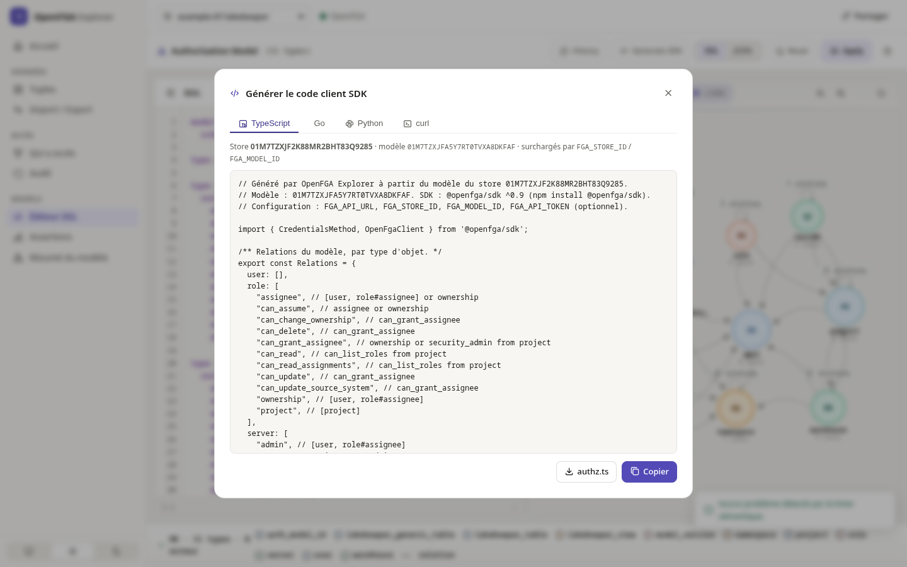

Modal launched from the Admin DSL page's **Generate SDK** button.

### Tabs

- **TypeScript** — typed client class per type, async methods for `check`, `write`, …
- **Go** — interface + struct per type.
- **Python** — async client with `FgaModelClient` + `*Relations` classes.
- **curl** — bash script of `curl` snippets (see [api.md](api.md) for the format).

### Copy

The **Copier** button puts the current tab's code on the clipboard.

---

## Modals & drawers

### Modals (overlay)

- **Add Tuple** — form to stage a new tuple (subject type + id, relation, object type + id).
- **Edit Authorization Model** — preview-only modal showing the active model.
- **Store Diff picker + result** — choose store B, view symmetric difference.
- **History** — list of authorization model versions.
- **Generate SDK** — see above.

### Drawers (right-edge)

- **Pending changes** — list of staged tuple adds/removes. Commit button batches them.
- **Tree sidebar** (graph view) — neighbors of the selected node, up to 5 hops.

### Toasts

Bottom-center ephemeral notifications. Used for "Saved", "Copied", "Store switched",
write errors, etc. Auto-dismiss after 3 seconds.

---

## Auth flows

### Login flow

1. User hits any non-public route → server returns 401 with `WWW-Authenticate: Bearer`.
2. Frontend redirects to `/login` (or `/auth/oidc/login` if OIDC is configured).
3. **OIDC mode**: bounce to the provider, callback to `/auth/callback`, server sets
   a session cookie, redirects to `/`.
4. **Local mode**: form with `admin` + `ADMIN_PASSWORD`. On success, session cookie.
5. **AUTH_DISABLED=1**: nothing — the UI loads directly.

### Session

A signed cookie named `openfga_explorer_session` (overridable via
`tuning.session_cookie_name`). TTL = `tuning.session_ttl` (default 8h).

### Logout

The logout button at the bottom of the sidebar calls `POST /auth/logout` (with
the CSRF token) and returns to the login page.

### Rate limit

`POST /auth/local` is capped at `RATE_LIMIT_PER_MIN` per IP. Above the threshold,
the server returns `429 Too Many Requests` with `Retry-After: 60`.

---

## Keyboard shortcuts

| Shortcut | Action |
|---|---|
| `Esc` | Close any open modal |
| `Ctrl/Cmd + K` | Focus the search box |
| `Enter` in search | Run search |

(Many more are documented in the in-app tour, accessible via the **?** icon.)